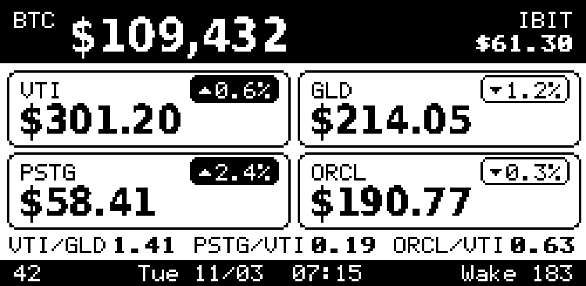
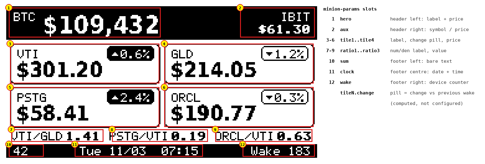

# Minion 3 display frame

**Status:** implemented · **Owner:** chinmay28 · **Consumer:** `minion-fw` on XIAO ESP32C6

HomeAPI renders the Minion 3 e-paper dashboard itself and serves it as a ready-to-blit 1-bit frame.
The device does one HTTP GET, writes 4,000 bytes to the panel, and sleeps for as long as the
response tells it to. The Python `minion-render` service and the on-device layout code both go away.

Reference rendering (1×, exactly what the panel shows): `docs/minion3/minion3_final_1x.png`.



---

## 1. Goals

1. **One request per wake.** Everything the device needs — pixels and sleep duration — in a single response.
2. **Rendering lives on the server.** The device has no fonts, no layout, no data parsing; it is a bitmap-to-panel pipe. Layout changes never require a firmware flash.
3. **Config is one ordinary entry.** Every slot on the panel is a named parameter in the `minion-params` entry — tickers, labels, prefixes, ratios, clock format, wake schedule — editable in the existing GUI, exported with everything else.
4. **Never fail the device.** Missing or stale data degrades the picture (`N/A`, a stale marker); the endpoint still returns 200 with a frame and a sleep time. The panel always shows *something* dated.
5. **Additive only.** No schema change, no changes to existing endpoints or response fields.

### Non-goals

- Partial-refresh/diff frames. Full-frame only; the panel does a full refresh per wake.
- Battery percentage. The carrier board has no battery sense; the footer shows the wake counter instead.
- A layout editor in the GUI. Layout is a fixed design with configurable *content*.
- Multiple devices/panel sizes. One display, `minion3`, 250×122. The URL carries the name so a second one is additive later.

---

## 2. Device contract

### 2.1 `GET /api/displays/minion3/frame.bin`

Returns the frame in the panel's native packing.

| | |
| --- | --- |
| Status | `200`, or `304` when `If-None-Match` matches |
| `Content-Type` | `application/octet-stream` |
| `Content-Length` | `4000` |
| `ETag` | `"<sha256 of body, first 16 hex>"` — strong |
| `Cache-Control` | `no-cache` |
| `X-Minion-Format` | `1` |
| `X-Minion-Sleep-Seconds` | integer in `[60, 86400]`: seconds the device should deep-sleep before the next GET |
| `X-Minion-Next-Wake` | RFC 3339 timestamp of the next wake, in `schedule.tz` |
| `X-Minion-Rendered-At` | RFC 3339 render time, in `schedule.tz` |
| `X-Minion-Stale` | present (value `1`) when the quotes used are older than `stale.after_minutes`, or carry no timestamp |

**Body (format 1):** 4,000 bytes = 250 rows × 16 bytes, panel-native portrait orientation (122 columns
wide, 250 rows tall), row-major, 8 pixels per byte, MSB = leftmost pixel, **bit 1 = white, 0 = black**.
Columns 122–127 of each row are padding and are always 1.

The landscape design (250 wide × 122 tall, FPC on the right) maps to native coordinates as
`native_x = y_land`, `native_y = 249 − x_land`. This is the same mapping as `FB_ROTATE 0` in
`minion-fw/components/framebuf`, so the device copies the body straight into `epd_display()`.

Query parameters (all optional; the device sends only `wake`):

| Param | Effect |
| --- | --- |
| `at=<RFC3339>` | Render as if it were this instant (drives the clock, the aux rotation, the stale check, the sleep computation). A request with `at` is **read-only**: it never touches stored data. Malformed ⇒ `400`. |
| `wake=<int ≥ 0>` | Wake counter to print in the footer; see 2.3. Malformed ⇒ `400`. |

Headers are also sent on `304`, so a device that skips the refresh still gets its sleep time.

### 2.2 `GET /api/displays/minion3/frame.png`

Same frame as a PNG for humans: the GUI preview, the phone, debugging. `?scale=N` (1–8, default 3)
upsamples with nearest-neighbour so pixels stay square. Same `X-Minion-*` headers; its own `ETag`
(the frame's tag plus the scale). `Content-Type: image/png`. **Never writes** — previews must not
move the change-pill baseline out from under the device (see 3.2).

### 2.3 `GET /api/displays/minion3/frame.bin?wake=N` — device telemetry

The device appends its wake counter (`wake=N`) and the server stores `{"wake": N, "at": <now, UTC>}`
in the entry `minion3-last-seen` (category `minion3`) on every `200` or `304`. Best-effort: a failed
write is logged and the frame is still served. This is the only write the device causes. (A `POST`
would be cleaner; it is a second round-trip and a second TLS handshake on a battery. One GET.)

### 2.4 Device behaviour (for reference; lives in `minion-fw`)

1. Wake → Wi‑Fi (cached BSSID/channel) → `GET …/frame.bin?wake=N` with `If-None-Match: <last ETag>` from RTC memory.
2. `200`: write body to panel, store ETag. `304`: skip the refresh. Either way sleep for `X-Minion-Sleep-Seconds`.
3. Any error or timeout: keep the current picture, sleep `min(2^k × 15 min, 6 h)` with `k` = consecutive failures.

---

## 3. Data sources

All reads are by key through the existing store; nothing new in the database.

| Entry key | Category | Written by | Read as |
| --- | --- | --- | --- |
| `minion-quotes` | `minion` | the existing quote fetcher (unchanged) | JSON object: symbol → price string (numbers are accepted too), plus `timestamp` (`MM/DD HH:MM:SS`; RFC 3339 also accepted) |
| `minion-sum` | `minion` | existing | plain text "magic sum" |
| `minion-params` | `minion` | the user, via GUI / API | JSON, see 3.1. Missing ⇒ built-in default that reproduces today's Minion content |
| `minion3-prev-quotes` | `minion3` | **this feature**, on each device wake where the quotes changed | the previous `minion-quotes` snapshot; used for the change pills |
| `minion3-last-seen` | `minion3` | **this feature** (2.3) | device telemetry |

The bitmap is a pure function of `minion-params`, `minion-quotes`, the entry named by `sum.key`,
the previous-quotes snapshot, the device's wake counter, and the clock. Nothing else influences a pixel.

A year-less quotes timestamp is read in `clock.tz` and given the current year, or the previous one
when that would place it more than a day in the future (a December fetch read on New Year's Day).

### 3.1 `minion-params` — one parameter per slot

Every region of the panel has a name. The names below are the keys in `minion-params`; the numbers
match the callouts in `docs/minion3/minion3_slots.png`.



| # | Slot | Where | What it shows | Parameters |
| --- | --- | --- | --- | --- |
| 1 | `hero` | header left | label + large price | `key`, `label`, `prefix`, `decimals` (default 0) |
| 2 | `aux` | header right, stacked | symbol over its price (bold) | `key` **or** `morning`/`evening`, `label`, `prefix`, `decimals` (default 2) |
| 3–6 | `tile1` … `tile4` | 2×2 grid | label, change pill, price | `key`, `label`, `prefix`, `decimals` (default 2) |
| 7–9 | `ratio1` … `ratio3` | ratio strip | `NUM/DEN` label + bold value | `num`, `den`, `label` (optional), `decimals` (default 2) |
| 10 | `sum` | footer left | bare text | `key` (an entry key; its text is shown verbatim) |
| 11 | `clock` | footer centre | date and time of render | `tz`, `format` (Go layout) |
| 12 | `wake` | footer right | `Wake n` from the device | `label` |
| — | `schedule` | not drawn | drives `X-Minion-Sleep-Seconds` | `tz`, `wake_times` |
| — | `pills` | inside tiles | computed change vs previous wake | `threshold_pct` |
| — | `stale` | replaces `clock` when quotes are old | `Stale 3h` | `after_minutes` |

```json
{
  "hero":   {"key": "BTC-USD", "label": "BTC",  "prefix": "$", "decimals": 0},
  "aux":    {"morning": "IBIT", "evening": "STRC", "prefix": "$", "decimals": 2},

  "tile1":  {"key": "VTI",  "label": "VTI",  "prefix": "$", "decimals": 2},
  "tile2":  {"key": "GLD",  "label": "GLD",  "prefix": "$", "decimals": 2},
  "tile3":  {"key": "P",    "label": "PSTG", "prefix": "$", "decimals": 2},
  "tile4":  {"key": "ORCL", "label": "ORCL", "prefix": "$", "decimals": 2},

  "ratio1": {"num": "VTI",  "den": "GLD", "decimals": 2},
  "ratio2": {"num": "P",    "den": "VTI", "label": "PSTG/VTI", "decimals": 2},
  "ratio3": {"num": "ORCL", "den": "VTI", "decimals": 2},

  "sum":    {"key": "minion-sum"},
  "clock":  {"tz": "America/Los_Angeles", "format": "Mon 01/02  15:04"},
  "wake":   {"label": "Wake"},

  "schedule": {"tz": "America/Los_Angeles", "wake_times": ["07:15", "19:15"]},
  "pills":    {"threshold_pct": 0.05},
  "stale":    {"after_minutes": 180}
}
```

Field semantics:

- **`key`** — the symbol exactly as it appears in `minion-quotes` (e.g. `P`). **`label`** — what the panel prints; defaults to `key`. Ratio labels default to `"<num label>/<den label>"` using the labels of any tile that shows that symbol, else the raw key — so `ratio2` above would read `PSTG/VTI` even without the explicit label.
- **`prefix`** — printed immediately before the number (`$`); omit or `""` for none. **`decimals`** — at most this many are shown; the source string is trimmed (rounded) to it, never padded with invented precision beyond what `minion-quotes` carries. `61.3` with `decimals: 2` prints `61.3`. Ratios are computed, so they always show exactly `decimals`.
- **`aux`** — either a fixed `key`, or `morning`/`evening` keys chosen by local time of day (before 12:00 in `clock.tz` ⇒ `morning`). If both `key` and the pair are present, `key` wins.
- **`sum.key`** — any entry key; the stored text is printed verbatim: trimmed, first line only, **no thousands separators or other formatting added**, at most 10 characters (a 10-digit number is the widest value that still clears the clock; longer text is cut at 10). Point it at a different entry and the slot shows something else; this is how the "magic sum" is reused as a free text slot.
- **`clock.format`** — a Go `time` layout. Default `Mon 01/02  15:04`.
- **`wake.label`** — default `Wake`; the number comes from the device's `?wake=` query (2.3) and reads `—` when absent. An empty label prints the bare number.
- **`schedule.wake_times`** — `HH:MM` local; drives the sleep computation (3.3). Not drawn.
- **`pills.threshold_pct`** — |Δ| below this shows no pill (3.2). `0` shows a pill for any non-zero move.
- **`stale.after_minutes`** — quotes older than this replace the clock with `Stale <n>h` and set `X-Minion-Stale: 1`. Under an hour the marker reads in minutes (`Stale 45m`), past two days in days (`Stale 3d`); quotes with no readable timestamp read plain `Stale`. `0` disables the check.

Rules:

- Slots are fixed: there are exactly four tiles and three ratio positions. A slot whose object is missing renders empty (tile outline stays; the ratio strip closes the gap). An unknown top-level key is ignored.
- The non-slot objects (`clock`, `wake`, `schedule`, `pills`, `stale`) fall back field by field to the defaults above when a configuration leaves them out — except `schedule.wake_times`, which is empty (⇒ sleep 12 h) unless you set it.
- Any slot whose `key` is absent from `minion-quotes` shows `N/A` in its number position and no pill. A price that is not a number is printed as-is behind the prefix.
- Invalid JSON, a missing `minion-params` entry, or a configuration that fails validation (a zone that does not load, a wake time that is not `HH:MM`, `decimals` outside 0–8, a negative threshold) ⇒ the built-in default above, and `sum` shows `Cfg?` so the problem is visible on the panel. The reason is in the server log.
- `minion-params` is an ordinary entry: edit it in the GUI, it rides along in `/api/export`, and `GET /api/displays/minion3/frame.png` shows the result immediately — no restart, no cache.

### 3.2 Change pills

`Δ% = (price − prev) / prev × 100` where `prev` comes from `minion3-prev-quotes`. The pill is
**filled** (white on black, ▲) for `Δ ≥ threshold_pct`, **outlined** (▼) for `Δ ≤ −threshold_pct`, and
omitted when there is no previous value, the previous value is zero, or |Δ| is under the threshold.
After a **device** render (`frame.bin` without `at`), if `minion-quotes.timestamp` differs from the
stored snapshot's (or, with no timestamps, the text differs), the snapshot is replaced. Two wakes a
day ⇒ the pill is the change since the previous wake (≈12 h), which is the number the owner wants to
see. PNG previews and `at=` renders read the snapshot but never replace it.

### 3.3 Sleep computation

`sleep = seconds until the next entry of schedule.wake_times after now, in schedule.tz`, computed by
building each candidate with `time.Date` in the loaded location, so DST transitions are correct by
construction (a 07:15 → 19:15 schedule sleeps 11 h across spring-forward and 13 h across fall-back).
Fractional seconds round up. Then clamp to `[60, 86400]`; when the clamp bites, `X-Minion-Next-Wake`
moves with it so the two headers always agree. If `schedule.wake_times` is empty, sleep 43200.
No jitter is added: the device's RC clock already drifts a few percent over 12 h, and the server
re-anchors it every wake.

---

## 4. Visual design

Fixed layout, 250×122, 1-bit, no dithering, no anti-aliasing. Every element is placed on an integer pixel grid.

```
y   0–26   Header band, black.  "BTC" (pixel 5x7, white) · hero price (DejaVu Sans Condensed Bold 20, white)
                                right, stacked: rotating symbol "IBIT" / its price "$61.30" in bold (pixel 5x7, white)
y  30–62   Tiles row 1          two rounded tiles, 121x33 outer, radius 4, 1-px outline, at x=3 and x=127
y  65–97   Tiles row 2             label (pixel 5x7) top-left · change pill top-right · "$" + price (DejaVu Condensed Bold 17)
y 101–107  Ratio strip          three "name value" groups; name regular, value bold; 3-px gap inside each, 4-px row margins, the two gaps between groups equal (pixel 5x7)
y 111–121  Footer band, black   left: the magic sum, bare number · right: "Wake n" · "Tue 11/03  07:15" centred in the free span between them (pixel 5x7, white)
```

### 4.1 Typography — the rule that matters

| Role | Face | Size | Why |
| --- | --- | --- | --- |
| Hero price, tile prices | **DejaVu Sans Condensed Bold** (Bitstream Vera licence, free) | 20 px, 17 px | Condensed so six digits + separator fit a 120-px tile; heavy strokes survive the 1-bit threshold; the figures are tabular, so prices line up across tiles. Chosen over Barlow/Oswald/Saira in a side-by-side (`docs/minion3/hybrid_options.png`). |
| Everything else | **5×7 pixel font** (the classic ks0108 GLCD table; the same one `minion-fw/components/framebuf` ships) | 5×7 px, 1-px spacing; **bold** = the glyph drawn twice 1 px apart (6×7, 7-px advance), used for the ratio values and the aux price | A bitmap font designed at this size. Any outline font below ~11 px turns to mush once thresholded — verified during design; see `docs/minion3/options.png` for the failure. |

Outline text is rasterised through `golang.org/x/image/font/opentype` at the target size and
thresholded at 50 % coverage; there is no hinting pass, so **sizes other than 17 and 20 must be
checked visually** before use. The full DejaVu Sans Condensed Bold face is embedded with `go:embed`
(≈650 KB) under `internal/display/fonts/` with its licence alongside — full rather than subset so any
`prefix` a configuration asks for has a glyph; the 5×7 table is a Go array in `font.go`.

### 4.2 Change pill

Height 12, radius 3, right-aligned in the tile with a 5-px margin: a 5×3 triangle, 2-px gap, then
`0.6%` in the pixel font. Filled = up, outlined = down. Direction is carried by fill, not by the glyph alone,
so it reads from across a room.

### 4.3 Number formatting

- Hero: thousands separators, `decimals` from config, prefix as configured.
- Tiles and aux: prefix + the price string from `minion-quotes` as-is, after trimming to `decimals`. Never re-round what the source already rounded.
- Missing symbol ⇒ `N/A` in the price slot, no pill.
- Stale quotes ⇒ the footer's date/time is replaced by `Stale 3h` and `X-Minion-Stale: 1` is set.
- Header and footer text is Title case (`Tue 11/03`, `Wake 183`, `Stale 3h`); labels print as configured; the magic sum is printed as a bare number with no label.
- The next wake time is not shown; it is in the `X-Minion-Next-Wake` header for anyone who wants it.

---

## 5. Implementation

### 5.1 Packages

```
internal/display/            pure rendering; no HTTP, no DB
  frame.go                   Frame: 250x122 bitmap held in native packing; Set/Get; Native() (4000 bytes); PNG(scale); PBM
  font.go                    5x7 pixel font table + opentype raster with 50 % threshold and a clip rect
  fonts/                     embedded DejaVu Sans Condensed Bold + LICENSE
  config.go                  Config, DefaultConfig, ParseConfig/Validate; Quotes, ParseQuotes; Inputs; Staleness
  format.go                  FormatPrice (trim-not-pad decimals, thousands), FormatComputed
  layout.go                  Render(cfg, in, now) (*Frame, error); Change/ClassifyChange for the pills
  schedule.go                NextWake(schedule, now) (next, sleepSeconds, error)
  testdata/golden.pbm        the fixture frame; regenerate with `go test ./internal/display -update`
internal/api/display.go      the handler: assemble Inputs from the store → display.Render → write; side effects
```

`display.Render` is deterministic for a given `(cfg, in, now)`; that is what makes golden tests
possible and what the `?at=` parameter leans on. Nothing in the package touches HTTP or the database.

### 5.2 Handler flow (`frame.bin`)

1. Parse `at`, `wake` (`400` on garbage). Load `minion-params` (default + `Cfg?` on miss/invalid), `minion-quotes`, the entry named by `sum.key`, `minion3-prev-quotes`.
2. `display.Render(...)` → frame. `display.NextWake(...)` → sleep seconds and next wake.
3. ETag = first 16 hex of SHA-256 of the native bytes. If `If-None-Match` matches (strong or weak, any list member, or `*`) → `304` with all `X-Minion-*` headers, no body.
4. Else `200` with body.
5. Best-effort side effects, after the response is written and only for a device request (`frame.bin` without `at`): update `minion3-prev-quotes` if the quotes timestamp changed; update `minion3-last-seen` if `wake` was given. Errors are logged, never surfaced.

Rendering cost is a few milliseconds; no caching layer is needed. The ETag is on the *output*, so an
unchanged picture (same quotes, same date line) yields a `304` and saves the device a 2-second refresh.

### 5.3 Router

`/api/displays/` is registered in `NewRouter` before the frontend fallback and dispatches on
`{name}/{frame.bin|frame.png}`; unknown display name or suffix ⇒ `404` JSON error in the existing
`writeError` shape. `GET` only; other methods are `405`.

### 5.4 GUI

A card on the dashboard, "Minion 3", showing `frame.png?scale=2`, the last-seen time and wake count,
and a link to the `minion-params` entry. One `` and two fields from `minion3-last-seen`.

### 5.5 Dependencies

`golang.org/x/image` (BSD) for `font/opentype` and `math/fixed`. Pure Go; keeps the no-CGO build.

---

## 6. Tests

| Test | Kind | Asserts |
| --- | --- | --- |
| `TestRender_Golden` | unit, `internal/display` | `Render(defaultCfg, fixtureInputs, fixedNow)` equals `testdata/golden.pbm` byte-for-byte. Regenerate with `-update`. |
| `TestRender_MatchesReferenceLayout` | unit | the fixed furniture sits where it does on the reference rendering: label, aux, ratio and footer x positions, tile outlines |
| `TestRender_Degraded` | unit | missing symbol → `N/A`, no pill; stale → `Stale nh`; missing params → `Cfg?`; empty slot → blank; zero denominator → `N/A`; never returns an error for bad data |
| `TestParams_Slots` | unit, table-driven | each slot's parameters land in its region and nowhere else (label, prefix, decimals, aux morning/evening, ratio default label, sum verbatim, wake label, clock zone) |
| `TestFrame_Native` | unit | a frame with one black pixel at landscape (x, y) sets exactly bit `native_x=y, native_y=249−x`; padding bits are 1; length 4000 |
| `TestPill_Thresholds` | unit, table-driven | +0.04 % → none, +0.05 % → filled, −0.05 % → outlined, no prev → none; rendered pill geometry |
| `TestNextWake_DST` | unit, table-driven | 07:15/19:15 across the spring-forward and fall-back nights in `America/Los_Angeles`; empty list → 43200; clamp bounds |
| `TestFrameHandlers` | handler | headers present and correct, `304` on matching ETag with headers still set, `?at=` honoured, `frame.png` decodes to 250×122×scale, `400`/`404`/`405` shapes |
| `TestFrameSideEffects` | handler | `minion3-prev-quotes` replaced only when the quotes timestamp changes; `minion3-last-seen` written on `?wake=`; previews never write |
| `TestDisplay_Compat` | integration | a database with no `minion-params` or `minion3-*` entries serves a frame; existing `/api/entries` responses unchanged |

Golden files live in `internal/display/testdata/`; the PBM is human-viewable in any image viewer, which is how a reviewer checks a visual diff.

---

## 7. Rollout

1. Land this feature behind nothing — the endpoints are additive and inert until a device calls them.
2. Create `minion-params` through the GUI (or let the default stand; the panel then says `Cfg?` in the sum slot until you do).
3. Point the firmware at `/api/displays/minion3/frame.bin`. The old `minion-quotes` pipeline keeps feeding both the old Pi device and the new one for as long as both exist.
4. Retire `minion-render` once the Pi is decommissioned.

## 8. Decisions taken from the open questions

- **`aux` rotation** — the default keeps the morning/evening rotation from Minion 2. Set `aux.key` for a fixed symbol.
- **`?wake=` telemetry** — kept. The device's GET is the only write path, and a preview never writes; a strictly read-only device needs only to drop the parameter, and the `wake` slot then shows `—`.
